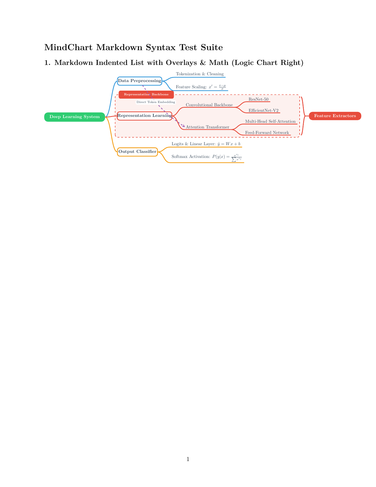
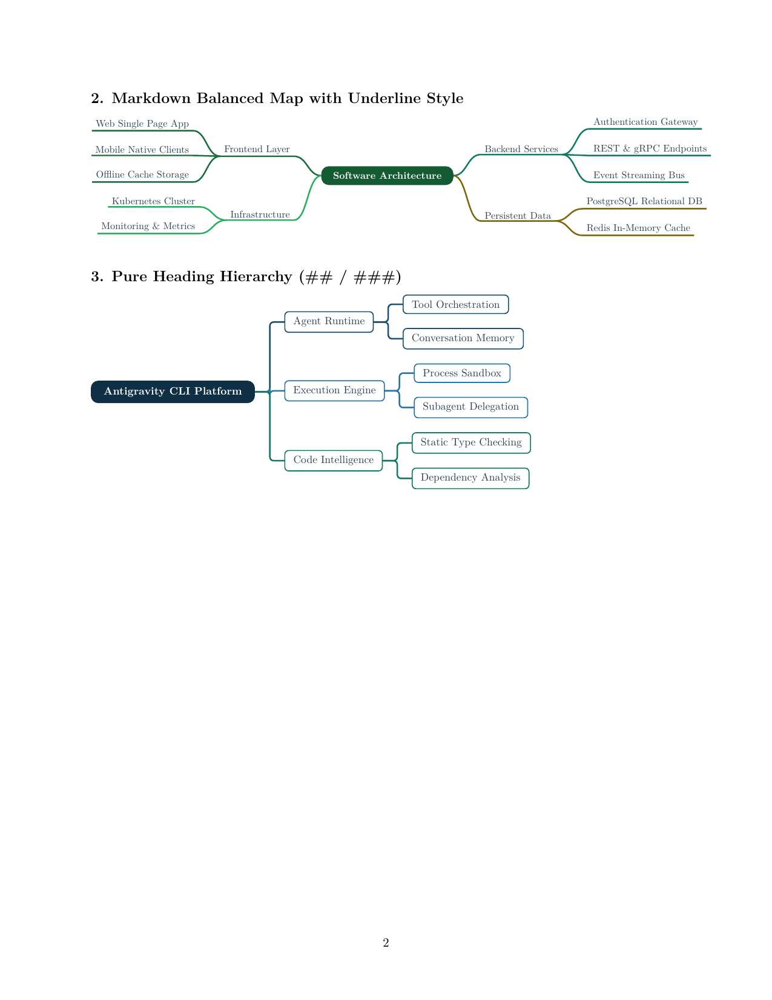

# `mindchart` — Modern XMind-Style Mind Maps for LaTeX

[](https://github.com/ruicx/latex-mind-chart/actions/workflows/ci.yml)
[](https://www.luatex.org/)
[](LICENSE)
[](docs/design.md)

`mindchart` is a high-performance LaTeX package that renders modern, elegant, XMind-style mind maps directly inside **LuaLaTeX**. 

By combining the computational power of **Lua 5.3+** with the vector rendering fidelity of **TikZ/PGF**, `mindchart` computes geometric layouts, exact text dimensions, organic Bézier curves, and overlays in a single compilation pass—**without external Python scripts, CLI tools, or `-shell-escape`**.

---

## 🌟 Key Features

- **🚀 Native & Zero External Dependencies**: Runs out-of-the-box on standard TeX Live, MacTeX, MiKTeX, and cloud environments like Overleaf.
- **📝 Dual Authoring Syntaxes**:
  - **Markdown Indented Lists** (Recommended): Rapidly author maps using `# Headings` and `- indented bullets`.
  - **Bracket Trees**: Nested Outliner format (`[Root [Branch [Leaf]]]`).
  - **Smart Auto-Detection**: Automatically identifies format without manual configuration.
- **📐 Sub-Millimeter Dimension Probing**: Queries TeX's internal box registers (`tex.box`) directly from Lua, measuring exact widths and heights of text, math formulas, and formatting macros before laying out nodes.
- **🎨 Composable Configuration Matrix**:
  - **5 Layouts**: Right-expanding logic chart, Left-expanding logic chart, Bi-directional balanced mind map (greedy bin-packing), Downward Organizational Chart (`layout=org` / `layout=down`), and Ishikawa / Fishbone Diagram (`layout=fishbone` / `layout=ishikawa`).
  - **7 Geometric Shapes**: Capsule (`capsule`/`pill`), Card (`card`), Sharp rectangle (`rect`), Diamond (`diamond`/`rhombus`), Hexagon (`hexagon`/`hex`), Ellipse (`ellipse`), Underline rule (`underline`).
  - **3 Visual Styles**: Classic (capsule root, card branches, underline leaves), Boxed (rounded cards), Underline (minimalist).
  - **3 Line Connectors**: Smooth cubic Bézier S-curves, Rounded orthogonal elbows, Straight lines.
  - **10 Curated Color Themes & Custom Palettes**: `rainbow`, `business`, `forest`, `monochrome`, `nord`, `morandi`, `dracula`, `ocean`, `sunset`, `solarized`, ad-hoc inline lists (`palette={...}`), and custom defined palettes (`\mindchartDefineTheme`).
- **✨ Overlays, Annotations & Micro-Icons**:
  - **Native Vector Micro-Icons**: Zero-dependency TikZ micro-glyphs (`icon=check|star|warn|fire|bulb|lock|...`) and LaTeX macro fallbacks.
  - **Summary Brackets (`\summary`)**: Mathematical cubic Bézier curly brackets encompassing entire subtrees with dedicated summary topic cards.
  - **Cross-Branch Relationships (`\rel`)**: Curved dashed connection arrows with automatic node boundary clipping, configurable curve angles, and text annotation badges.
  - **Subtree Folding & Indicators**: Collapse busy subtrees with `collapsed` / `folded` and render neat `+N` badge indicators.
  - **PDF Document Bookmarks**: Auto-emit nested PDF bookmarks synchronized with `hyperref` (`bookmarks=true`).
- **🔍 Proportional Scaling**: Seamless scaling via `scale=<factor>` where coordinates, fonts, and node shapes scale in perfect lockstep.

---

## 🖼️ Gallery & Showcases

### 1. Markdown Indented List with Overlays & Math

```latex
\begin{mindchart}[layout=right, theme=rainbow, style=classic, line=curve, scale=0.72]
# Deep Learning System, color=2ECC71
  - Data Preprocessing, name=data, color=3498DB
    - Tokenization \& Cleaning
    - Feature Scaling: $x' = \frac{x - \mu}{\sigma}$
  - Representation Learning, name=rep, color=E74C3C
    - Convolutional Backbone, name=cnn
      - ResNet-50
      - EfficientNet-V2
    - Attention Transformer, name=tf
      - Multi-Head Self-Attention
      - Feed-Forward Network
  - Output Classifier, name=out, color=F39C12
    - Logits \& Linear Layer: $\hat{y} = Wx + b$
    - Softmax Activation: $P(y|x) = \frac{e^{z_i}}{\sum e^{z_j}}$
\summary[color=E74C3C]{cnn}{tf}{Feature Extractors}
\rel[bend=-10, to_anchor=west, pos=0.35, color=9B59B6]{data}{tf}{Direct Token Embedding}
\end{mindchart}
```



---

### 2. Balanced Map (Underline Style) & Pure Heading Hierarchy



---

## ⚡ Quick Start

### Requirements
- **LuaLaTeX** (`lualatex`).
- LaTeX packages `tikz` and `xcolor` (automatically loaded).

### Minimal Example

Save the following as `example.tex` and compile with `lualatex example.tex`:

```latex
\documentclass{article}
\usepackage{mindchart}

\begin{document}

\begin{mindchart}[layout=right, theme=rainbow]
# Machine Learning Architecture
  - Data Pipeline
    - Feature Normalization: $z = \frac{x - \mu}{\sigma}$
    - Data Augmentation
  - Model Core, name=model
    - Convolutional Layers, name=conv
    - Transformer Attention, name=attn
  - Prediction Head, name=head
    - Linear Projection: $\hat{y} = Wx + b$
    - Loss Calculation
\summary{conv}{attn}{Feature Encoders}
\rel[bend=25]{model}{head}{Forward Pass}
\end{mindchart}

\end{document}
```

---

## ⚙️ Configuration Reference

Options are passed as comma-separated key-value pairs to `\begin{mindchart}[...]`:

| Option | Values | Default | Description |
| :--- | :--- | :---: | :--- |
| `layout` | `right`, `balanced`, `left`, `org`, `down` | `right` | Overall mind map geometric layout algorithm. |
| `style` | `classic`, `boxed`, `underline` | `classic` | Visual card / box shape for nodes across hierarchy levels. |
| `line` | `curve`, `elbow`, `straight` | `curve` | Connector line geometry. |
| `theme` | `rainbow`, `business`, `forest`, `monochrome`, `nord`, `morandi`, `dracula`, `ocean`, `sunset`, `solarized` | `rainbow` | Branch palette with automatic color propagation. |
| `palette` | `{HEX1, HEX2, ...}` | *none* | Ad-hoc inline hex color palette. |
| `bookmarks`| `true`, `false` | `false` | Generate nested PDF document bookmarks via `hyperref`. |
| `scale` | `<float>` (e.g. `0.85`, `1.2`) | `1` | Equiproportional scale for coordinates, boxes, and text. |
| `syntax` | `markdown`, `bracket` | *auto* | Authoring syntax format (auto-detected by default). |

### Overlays & Node Flags

- **Summary Brackets**:
  ```latex
  \summary[options]{from_node_name}{to_node_name}{Summary Label}
  ```
- **Cross-Branch Relationships**:
  ```latex
  \rel[options]{from_node_name}{to_node_name}{Relationship Label}
  ```
  - Options: `color=<hex|name>`, `bend=<degrees>`, `line=<dashed|solid|dotted>`, `pos=<0.0-1.0>`, `side=<above|below|auto>`, `from_anchor=<anchor>`, `to_anchor=<anchor>`, `fill=<color|none>`.
- **Subtree Folding**:
  ```latex
  - Complex Subsystem, collapsed
    - Hidden Child 1
    - Hidden Child 2
  ```

---

## 📦 Distribution & Packaging

`mindchart` includes a standalone packaging engine that generates CTAN-ready zip archives and TeX Directory Structure (TDS) bundles:

```pwsh
python scripts/build_package.py
```

Generated distribution archives:
- `dist/mindchart.tds.zip`: Installable directly into `TEXMFHOME` or `TEXMFLOCAL`.
- `dist/mindchart.zip`: Complete archive ready for CTAN submission containing sources, docs, examples, and the TDS bundle.

---

## 📚 Documentation

For in-depth specifications and guides, refer to the `docs/` directory:

- [Requirements Specification (`docs/requirements.md`)](docs/requirements.md): System requirements, configuration matrix, and design goals.
- [System Architecture & Design (`docs/design.md`)](docs/design.md): Three-tier architecture, pipeline stages, AST structures, and algorithms.
- [User Guide (`docs/user_guide.md`)](docs/user_guide.md): Comprehensive reference, option tables, syntax examples, and overlay guide.
- [Agent & Contributor Guidelines (`AGENTS.md`)](AGENTS.md): Coding rules, invariants, and verification workflows for agents and developers.

---

## 📄 License

This project is licensed under the [MIT License](LICENSE).

## Development verification / 开发验证

Run `python scripts/run_tests.py` to execute all checks. See [the test guide](test/README.md) for prerequisites, groups, and visual inspection. Generated files are stored in `build/test/`.

运行 `python scripts/run_tests.py` 执行全部检查。依赖工具、测试分组和视觉检查说明见[测试指南](test/README.md)。生成文件保存在 `build/test/`。
