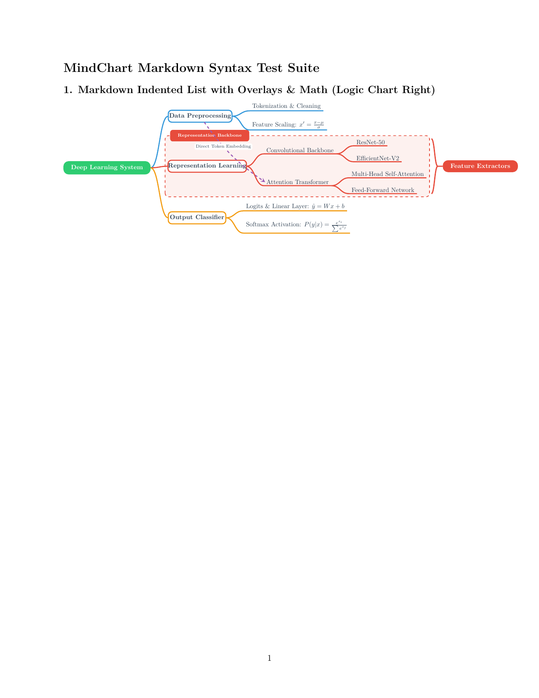
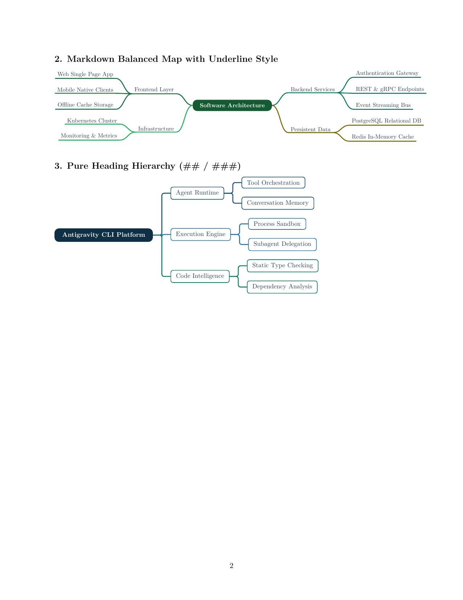
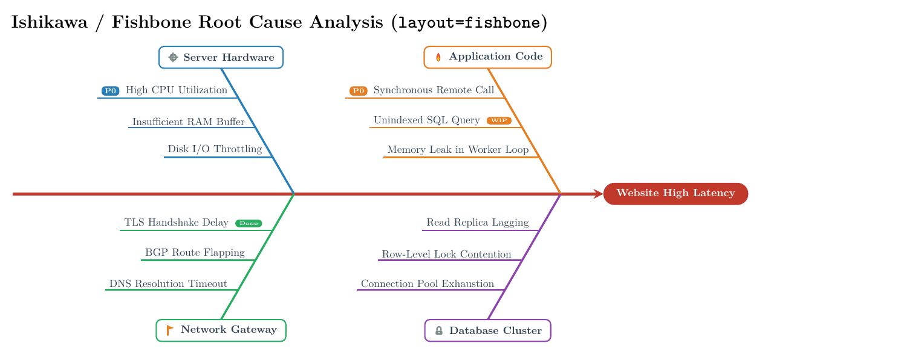
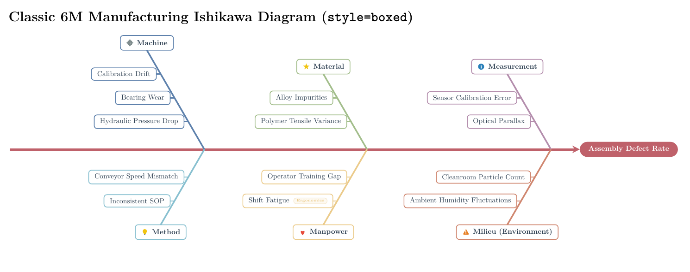

# `mindchart` — 用于 LaTeX 的 XMind 风格思维导图

[English README](README.md)

[](https://github.com/ruicx/latex-mind-chart/actions/workflows/ci.yml)
[](https://www.luatex.org/)
[](LICENSE)
[](docs/design.md)

`mindchart` 是一个在 **LuaLaTeX** 内直接绘制 XMind 风格思维导图的 LaTeX 宏包。

宏包结合 **Lua 5.3+** 的布局计算与 **TikZ/PGF** 的矢量绘图能力，在一次编译中完成精确文字测量、节点布局、贝塞尔曲线和覆盖元素绘制，**运行时不需要外部 Python 脚本、命令行工具或 `-shell-escape`**。

---

## 🌟 主要功能

- **🚀 原生运行**：在 LuaLaTeX 内完成测量、布局和绘图，可用于 TeX Live、MacTeX、MiKTeX 和 Overleaf 等环境。
- **📝 两种输入语法**：
  - **Markdown 缩进列表**（推荐）：用 `#` 标题和缩进的 `-` 列表编写导图。
  - **方括号树**：使用嵌套结构，例如 `[Root [Branch [Leaf]]]`。
  - **自动识别**：默认根据输入内容选择语法。
- **📐 精确尺寸测量**：通过 Lua 读取 TeX 盒子寄存器 `tex.box`，在布局前测量文字、数学公式和格式命令的实际宽高。
- **🎨 布局与外观配置**：
  - **5 种布局**：向右、向左、双向平衡（贪心分配分支）、向下组织结构图（`layout=org` / `layout=down`）以及鱼骨图（`layout=fishbone` / `layout=ishikawa`）。
  - **7 种几何形状**：胶囊（`capsule` / `pill`）、圆角卡片（`card`）、矩形（`rect`）、菱形（`diamond` / `rhombus`）、六边形（`hexagon` / `hex`）、椭圆（`ellipse`）、下划线（`underline`）。
  - **3 种视觉样式**：经典样式（胶囊根节点、卡片分支、下划线叶节点）、卡片样式、下划线样式。
  - **4 种连线**：三次贝塞尔曲线、渐细带状连线、圆角折线和直线。
  - **10 种配色主题与自定义调色板**：`rainbow`、`business`、`forest`、`monochrome`、`nord`、`morandi`、`dracula`、`ocean`、`sunset`、`solarized`，支持临时调色板 `palette={...}` 和通过 `\mindchartDefineTheme` 注册主题。
- **✨ 覆盖元素、标注与图标**：
  - **矢量图标**：内置 TikZ 图标（`icon=check|star|warn|fire|bulb|lock|...`），也支持 LaTeX 宏。
  - **摘要括号（`\summary`）**：用贝塞尔大括号覆盖指定范围的完整子树，并附带摘要卡片。
  - **跨分支关系线（`\rel`）**：支持弯曲虚线箭头、节点边界裁剪、弯曲角度和文字标签。
  - **子树折叠**：通过 `collapsed` / `folded` 隐藏子树，并显示 `+N` 提示。
  - **PDF 书签**：配合 `hyperref`，通过 `bookmarks=true` 导出层级书签。
- **🔍 等比例缩放**：`scale=<factor>` 同时缩放坐标、文字和节点形状。

---

## 🖼️ 示例展示

### 1. 包含覆盖元素与公式的 Markdown 导图

```latex
\begin{mindchart}[layout=right, theme=rainbow, style=classic, line=curve, scale=0.72]
# Deep Learning System, color=2ECC71
  - Data Preprocessing, name=data, color=3498DB
    - Tokenization \& Cleaning
    - Feature Scaling: $x' = \frac{x - \mu}{\sigma}$
  - Representation Learning, name=rep, color=E74C3C
    - Convolutional Backbone, name=cnn
      - ResNet-50
      - EfficientNet-V2
    - Attention Transformer, name=tf
      - Multi-Head Self-Attention
      - Feed-Forward Network
  - Output Classifier, name=out, color=F39C12
    - Logits \& Linear Layer: $\hat{y} = Wx + b$
    - Softmax Activation: $P(y|x) = \frac{e^{z_i}}{\sum e^{z_j}}$
\summary[color=E74C3C]{cnn}{tf}{Feature Extractors}
\rel[bend=-10, to_anchor=west, pos=0.35, color=9B59B6]{data}{tf}{Direct Token Embedding}
\end{mindchart}
```



---

### 2. 双向平衡导图与纯标题层级



---

### 3. 鱼骨图与因果分析

使用 `layout=fishbone`（别名 `ishikawa`）绘制问题、类别、原因三级结构。
类别默认在主干上下交替排列，可在类别上设置 `side=top` 或 `side=bottom` 指定位置。
`style=classic` 使用下划线原因节点，`style=boxed` 使用卡片原因节点。





参见[示例源码](test/visual/test_fishbone.tex)和[鱼骨图指南](docs/user_guide.md#39-fishbone--cause-and-effect-diagrams-layoutfishbone--layoutishikawa)。

---

## ⚡ 快速开始

### 环境要求

- **LuaLaTeX**（`lualatex`）。
- LaTeX 宏包 `tikz` 和 `xcolor`，由 `mindchart` 自动加载。

### 最小示例

将以下内容保存为 `example.tex`，使用 `lualatex example.tex` 编译：

```latex
\documentclass{article}
\usepackage{mindchart}

\begin{document}

\begin{mindchart}[layout=right, theme=rainbow]
# Machine Learning Architecture
  - Data Pipeline
    - Feature Normalization: $z = \frac{x - \mu}{\sigma}$
    - Data Augmentation
  - Model Core, name=model
    - Convolutional Layers, name=conv
    - Transformer Attention, name=attn
  - Prediction Head, name=head
    - Linear Projection: $\hat{y} = Wx + b$
    - Loss Calculation
\summary{conv}{attn}{Feature Encoders}
\rel[bend=25]{model}{head}{Forward Pass}
\end{mindchart}

\end{document}
```

---

## ⚙️ 配置参考

配置以逗号分隔的键值对写在 `\begin{mindchart}[...]` 的同一行，树内容从下一行开始。
下表中的数值间距和线宽以 pt 为单位，宽度及整图适配选项接受 TeX 长度。

### 布局与输入

| 选项 | 取值 | 默认值 | 说明 |
| :--- | :--- | :---: | :--- |
| `layout` | `right`、`left`、`balanced` / `mindmap`、`org` / `down` / `vertical` / `tree_down`、`fishbone` / `ishikawa` / `cause_effect` | `right` | 树的展开方向或鱼骨图布局。鱼骨图仅支持问题、类别、原因三级结构。 |
| `syntax` | `auto`、`markdown` / `md`、`bracket` | `auto` | 自动识别 Markdown 或方括号输入，也可显式指定。 |
| `equal_branch_length` | `true`、`false` | `false` | 按水平列对齐节点的左右边界，可见叶节点共用末列。仅适用于 `right`、`left` 和 `balanced` / `mindmap`。 |
| `level_sep` | 数值 | `28`；纵向为 `26` | 树的层间距，不控制鱼骨图斜骨。 |
| `sibling_sep` | 数值 | `14`；纵向为 `18` | 同级子树间距，也参与计算鱼骨图原因节点的最小间距。 |

等长分支对齐节点列，不统一曲线连线的长度；双向布局的左右两侧独立对齐。
参见[布局说明](docs/user_guide.md#21-layout-options-layout--name)。

### 样式与文字

| 选项 | 取值 | 默认值 | 说明 |
| :--- | :--- | :---: | :--- |
| `style` | `classic`、`boxed`、`underline` | `classic` | 各层级节点的默认视觉样式。 |
| `shape` | `capsule`、`card`、`rect`、`diamond`、`hexagon`、`ellipse`、`underline` | 按样式和深度确定 | 默认节点形状，节点局部形状优先。 |
| `line` | `curve`、`tapered` / `organic`、`elbow`、`straight` | `curve`；纵向为 `elbow` | 树的连线形式。鱼骨图使用直线斜骨和水平原因连线。 |
| `line_width` | 数值 | `1.2` | 树的连线宽度。鱼骨图斜骨更粗，主干线宽固定为 2.4pt。 |
| `theme` | `rainbow`、`business`、`forest`、`monochrome`、`nord`、`morandi`、`dracula`、`ocean`、`sunset` / `warm`、`solarized` 或已注册的主题名 | `rainbow` | 分支调色板，后代节点继承分支颜色。 |
| `palette` | `{HEX1, HEX2, ...}` | 主题调色板 | 覆盖分支调色板；若未覆盖根节点颜色，首个颜色也用于根节点。 |
| `root_color` | 十六进制颜色或颜色名 | 主题根节点颜色或临时调色板首色 | 覆盖根节点颜色。 |
| `max_width` | TeX 长度，如 `4cm` | 未设置 | 默认文字换行宽度，节点局部设置优先。 |
| `align` | `left`、`center`、`right` | `center` | 默认多行文字对齐方式。 |
| `root_style` | `{key=value, ...}` | 未设置 | 深度为 0 的节点共享选项。 |
| `branch_style` | `{key=value, ...}` | 未设置 | 深度为 1 的节点共享选项。 |
| `leaf_style` | `{key=value, ...}` | 未设置 | 深度为 2 及更深节点的共享选项，包括这些深度的中间节点。 |

节点局部选项优先于层级共享选项；独立注释及覆盖元素标签不继承这些样式组。
参见[层级共享样式](docs/user_guide.md#52-shared-styles-by-hierarchy-level)。

### 缩放与排版

| 选项 | 取值 | 默认值 | 说明 |
| :--- | :--- | :---: | :--- |
| `scale` | 比例，如 `0.85`、`1.2` | `1` | 在整图适配前，同时缩放坐标、形状和文字。 |
| `fit_width`、`fit_height` | 非负 TeX 长度，如 `\linewidth`、`18cm` | 不限制 | 将包含覆盖元素的完整图缩小到指定尺寸以内。零表示不限制该方向；适配不会放大图。 |
| `min_font_size` | 数值 | `6` | 适配后最小可见主标签字号低于该值时发出警告，不覆盖尺寸限制。 |
| `avoid_overlaps` | `true`、`false` | `false` | 移动覆盖元素标签和摘要卡片，避开可见节点框及其他覆盖元素标签。连线仍可能交叉。 |

整图适配包含覆盖元素；最小字号仅用于告警，覆盖元素避让不保证连线路径无交叉。
参见[排版功能与限制](docs/user_guide.md#5-publication-layout-and-navigation)。

### 书签

加载 `hyperref` 后可将图的层级写入 PDF 书签。

| 选项 | 取值 | 默认值 | 说明 |
| :--- | :--- | :---: | :--- |
| `bookmarks` | `true`、`false` | `false` | 生成嵌套 PDF 书签。 |
| `bookmark_depth` | 整数 | `4` | 导出的最大节点深度，根节点深度为 0。 |
| `bookmark_level` | 整数 | `1` | 根节点在 PDF 大纲中的层级。 |
| `bookmark_collapsed` | `true`、`false` | `false` | 将已折叠节点下隐藏的后代也加入书签。 |

### 覆盖元素与节点标记

- **摘要括号**：
  ```latex
  \summary[options]{from_node_name}{to_node_name}{Summary Label}
  ```
- **跨分支关系线**：
  ```latex
  \rel[options]{from_node_name}{to_node_name}{Relationship Label}
  ```
  - 选项：`color=<hex|name>`、`bend=<degrees>`、`line=<dashed|solid|dotted>`、`pos=<0.0-1.0>`、`side=<above|below|auto>`、`from_anchor=<anchor>`、`to_anchor=<anchor>`、`fill=<color|none>`。
- **子树折叠**：
  ```latex
  - Complex Subsystem, collapsed
    - Hidden Child 1
    - Hidden Child 2
  ```

详细参数参见[节点格式](docs/user_guide.md#33-node-naming--per-node-options)、
[摘要、关系线及边界](docs/user_guide.md#4-overlay-elements)、
[独立注释](docs/user_guide.md#54-independent-notes)和
[PDF 链接](docs/user_guide.md#55-pdf-links-and-references)。

---

## 📦 发布与打包

项目提供打包脚本，生成 CTAN 发布压缩包和 TeX 目录结构（TDS）安装包：

```pwsh
python scripts/build_package.py
```

生成的文件：

- `dist/mindchart.tds.zip`：可安装到 `TEXMFHOME` 或 `TEXMFLOCAL`。
- `dist/mindchart.zip`：包含源码、文档、示例和 TDS 安装包的 CTAN 发布包。

---

## 📚 文档

详细规范与指南位于 `docs/`，内容为英文：

- [需求规范（`docs/requirements.md`）](docs/requirements.md)：系统需求、配置矩阵和设计目标。
- [系统架构与设计（`docs/design.md`）](docs/design.md)：三层架构、流水线、AST 结构及算法。
- [用户指南（`docs/user_guide.md`）](docs/user_guide.md)：完整配置、语法示例与覆盖元素用法。
- [开发与代理规范（`AGENTS.md`）](AGENTS.md)：编码规则、架构约束、验证流程和提交规范。

---

## 📄 许可证

本项目使用 [MIT 许可证](LICENSE)。

## 文档排版

排版功能包括整图尺寸适配（`fit_width`、`fit_height`）、可选的覆盖元素避让
（`avoid_overlaps=true`）、层级样式（`root_style`、`branch_style`、`leaf_style`）、
独立 `\note` 卡片和 PDF 链接（`href`、`ref`、`target`、`node_ref`）。
用法与限制参见[用户指南](docs/user_guide.md#5-publication-layout-and-navigation)，
中文复杂图参见[排版示例](test/visual/test_publication.tex)。

## 开发验证

运行 `python scripts/run_tests.py` 执行全部检查。依赖工具、测试分组和视觉检查说明参见
[测试指南](test/README.md)。生成文件保存在 `build/test/`。
